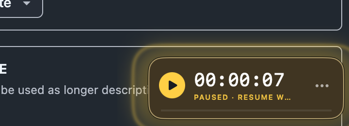

# Worklight

A quiet, native macOS work timer that keeps your day visible in a small floating window.

Worklight runs locally on your Mac. It has no account, server, analytics, or network access. Each Mac user gets their own private timer history and preferences.



## Features

- Always-on-top stopwatch at the bottom-right of your primary display, with a menu bar control.
- Custom daily target, set to 8 hours by default, with a progress bar and seven-day summary.
- Pause tracking when you lock your Mac or close its lid, then choose whether the away time counts.
- Restart recovery that preserves recorded time and asks you to classify any uncertain gap.
- Repeating pause pulse with a wide, click-through amber halo and adjustable notification.
- A large 40 × 40 point menu button, drag-to-move timer, and optional launch at login.
- Local minute corrections for missed starts or pauses.
- No input logging, screen recording, accessibility permissions, or account setup.

## Start

1. Open the DMG and drag **Worklight.app** onto **Applications**. Quit any running copy before replacing it, then open the installed app.
2. Allow notifications when macOS asks. Worklight has a small in-app fallback if you decline. Focus modes and system notification settings can still silence native banners.
3. Click the yellow play button in the bottom-right timer to start your workday.
4. Open **Today & settings** from the timer’s ••• menu or the stopwatch in your menu bar to set your daily target.

Opening Worklight again while it is already running brings its dashboard back. Use Command-comma for settings and Command-Q to quit while Worklight is active.

The floating timer and menu-bar stopwatch are both enabled. The ••• button has a padded 40 × 40 point clickable area. Drag the timer by its numbers; choose **Move timer to bottom-right** from its menu to restore its position.

The universal release supports **Apple Silicon and Intel Macs**, running macOS 13 or later. It is ad-hoc signed and not Apple-notarized. If macOS blocks the downloaded copy, Control-click the app and choose **Open**, or use **Open Anyway** in System Settings → Privacy & Security. Keep Gatekeeper enabled.

## How it behaves

- The small floating timer shows your accumulated work **today**, in local calendar time. The line underneath shows progress toward your daily target (8 hours initially).
- Click the yellow button to start, pause, or resume. Drag the numbers to move it. It stays within the primary display. **Move timer to bottom-right** restores its position.
- It follows macOS desktops and is configured to accompany full-screen apps. macOS system/security overlays can cover it. Full-screen and display behavior should be checked on your monitor setup.
- Lock the screen or close the lid while working: Worklight stops adding time temporarily. On return, choose **That was a break · resume work**, **That was work · continue**, or **Still on break**. A break excludes the whole uncertain interval, including the time spent deciding. “Work” includes that interval up to your decision.
- If you had already paused before locking or closing the lid, it stays paused without asking you to classify the interval.
- Normal mouse/keyboard inactivity never pauses the timer and never triggers an away-time question. A system sleep by itself silences reminders; lock/lid events determine away-time classification. Closing the lid also counts as away when external displays keep the Mac awake.
- While paused, time with the Mac awake, unlocked and lid-open advances the reminder clock. Reading counts without moving the mouse or typing. After 2 minutes, the timer and menu-bar icon pulse repeatedly until you resume, snooze, finish the day, or lock/close the Mac. After 5 minutes, a notification offers **Resume work** or **Snooze 10 min**. Notifications repeat after another 10 eligible paused minutes. The first two thresholds are configurable.
- The reminder radiates a larger amber halo and expanding outline beyond the timer. The halo is click-through, so the timer's interactive footprint stays small. macOS Reduce Motion is respected.
- Today and Settings show a reminder countdown or an explanation when reminders are quiet. **Test reminder** in Settings flashes the timer for 10 seconds and requests a test banner if notifications are enabled, without changing your work total.
- Reminder progress and snoozing survive an app restart. Time while the app is closed is excluded. Delayed background timer ticks count their full eligible interval.
- No keyboard/mouse activity monitoring is needed. Worklight does not record keys, mouse positions, screenshots, window titles, or app usage. No Accessibility, Input Monitoring or Screen Recording permission is requested.
- Reaching the daily target alerts you once that day. Counting continues so you decide when to stop.
- **Finish day** stops the timer and silences paused reminders until you start again. No reminders happen before your first session of a new day.
- **Today** offers signed minute corrections, such as `-20` or `+10`, and the last seven daily totals. A total cannot go below zero.
- Quitting stops the current session. If the app crashes, it recovers its last checkpoint (saved every 15 seconds) and asks how to classify the uncertain gap at relaunch.

## Data

No accounts, server, analytics, or network requests. Work history and settings are saved locally at `~/Library/Application Support/Worklight/state.json`. The floating position is kept in your macOS preferences. Back up that JSON file if you want a separate copy of your history. Enable **Launch Worklight at login** in Settings; macOS may ask you to approve it in System Settings → General → Login Items.

## Build from source

The repository is a Swift package with no external dependencies. Install Apple’s Command Line Tools (`xcode-select --install`) if needed, then run:

```sh
bash Build.sh
open dist/Worklight.app
```

To build a universal DMG:

```sh
bash PackageDMG.sh
```

To build only for the current Mac, set `WORKLIGHT_ARCHS=arm64` on Apple Silicon or `WORKLIGHT_ARCHS=x86_64` on Intel. For core tests, run:

```sh
CLANG_MODULE_CACHE_PATH="$PWD/.build-local/module-cache" \
SWIFT_MODULECACHE_PATH="$PWD/.build-local/module-cache" \
swift run --disable-sandbox \
  --scratch-path "$PWD/.build-local/swift-build" \
  --cache-path "$PWD/.build-local/swift-cache" \
  --config-path "$PWD/.build-local/swift-config" \
  --security-path "$PWD/.build-local/swift-security" WorklightChecks
```

For an isolated manual test, launch the executable with `--data-dir /absolute/path/to/a/test-directory`. This keeps its timer history separate from real work history.

## Detection notes

Lid changes use the IOKit power-management notification plus the lid-state property; screen lock/unlock uses macOS distributed lock notifications and user-session notifications. Distributed lock notifications are not a guaranteed public API and need a real-device check on macOS upgrades. No display-sleep event is interpreted as a break. Hardware lid closure, real lock/unlock, native notification delivery, and multi-monitor/full-screen behavior require a manual check on your Mac; automated tests exercise the accounting and reminder logic.

The 17 automated checks cover accounting across breaks, repeated lock signals, midnight, corrections, crash recovery, paused reminder eligibility without input, delayed timer ticks, continuous pulses, reminder persistence, snooze boundaries and notification repeat timing.
